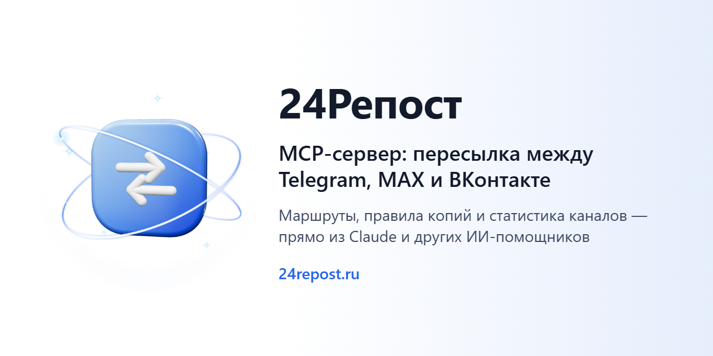

# 24Репост — сервер MCP



[24Репост](https://24repost.ru/?ot=d_gh) пересылает посты между Telegram, MAX и ВКонтакте:
пишете в один канал — пост появляется в остальных, правки и удаления доходят до копий.

Сервер MCP даёт вашему ИИ-помощнику — Claude, Cursor, ChatGPT — те же действия, что и
кабинет: посмотреть чаты и маршруты, создать маршрут, поставить на паузу, настроить
стоп-слова, расписание и подпись, собрать черновик чат-бота. Вы пишете помощнику
обычными словами: «перешли новые посты из моего канала в Telegram в канал MAX, но без
рекламы» — он делает это сам.

## Что умеет

| Группа | Инструменты |
|---|---|
| Чаты и маршруты | `chats_list`, `routes_list`, `route_show`, `route_create`, `route_pause`, `route_resume`, `route_change_target`, `route_set_two_way` |
| Правила копий | `route_configure`, `route_set_words`, `route_set_replacements`, `route_set_frame_text`, `route_set_attachments`, `route_set_ad_filter`, `route_set_schedule`, `route_set_delay`, `route_set_utm` |
| Группы маршрутов | `group_create`, `group_rename`, `route_set_group` |
| Перенос истории канала | `import_start`, `import_show`, `import_pause`, `import_resume`, `import_cancel` |
| Чат-боты | `chatbots_list`, `chatbot_show`, `chatbot_rules`, `chatbot_save`, `chatbot_stats` |
| Статистика | `channel_stats` |

Точный перечень для вашего ключа отдаёт `tools/list`: инструменты, на которые у ключа
нет прав, помощнику не показываются.

**Чего сервер не делает:** не удаляет маршруты и группы, не включает сценарии чат-ботов
(сохраняет только черновик — включаете вы в кабинете) и не передаёт тексты ваших
сообщений: сервис их не хранит.

## Подключение

1. Войдите в кабинет [my.24repost.ru](https://my.24repost.ru) и откройте «Ключи доступа».
2. Выдайте ключ: права «Смотреть» или «Смотреть и менять», срок, при желании — список
   адресов. Ключ показывается один раз.
3. Добавьте сервер в свой клиент.

Адрес сервера: `https://my.24repost.ru/mcp` (транспорт Streamable HTTP), ключ — в
заголовке `Authorization: Bearer aibo_live_…`.

**Claude Desktop** — `claude_desktop_config.json` (нужен Node.js):

```json
{
  "mcpServers": {
    "24repost": {
      "command": "npx",
      "args": ["-y", "mcp-remote", "https://my.24repost.ru/mcp", "--header", "Authorization:${AIBO_AUTH}"],
      "env": { "AIBO_AUTH": "Bearer aibo_live_…" }
    }
  }
}
```

**Claude Code:**

```bash
claude mcp add --transport http 24repost https://my.24repost.ru/mcp --header "Authorization: Bearer aibo_live_…"
```

**Cursor** — `~/.cursor/mcp.json`:

```json
{
  "mcpServers": {
    "24repost": {
      "url": "https://my.24repost.ru/mcp",
      "headers": { "Authorization": "Bearer aibo_live_…" }
    }
  }
}
```

**ChatGPT** — «Приложения» → режим разработчика → свой сервер MCP: адрес
`https://my.24repost.ru/mcp`, ключ — в заголовке `Authorization`.

## Безопасность

- Ключ действует от вашего имени и видит только ваши чаты и маршруты.
- Каждое изменение через ключ записано в журнал действий кабинета; отозвать ключ можно
  в любой момент — он перестаёт работать сразу.
- Предел — 60 запросов в минуту на ключ.

## English

24Repost is a cross-posting service for Telegram, MAX and VK. This remote MCP server
(`https://my.24repost.ru/mcp`, Streamable HTTP, bearer token from the cabinet's
“Ключи доступа” page) lets an AI assistant list chats and routes, create and pause
forwarding routes, set stop words, schedules and captions, import channel history and
draft chatbot scenarios. It never deletes routes, never activates chatbots and never
receives message texts.

---

Сайт: [24repost.ru](https://24repost.ru/?ot=d_gh) · бот в [Telegram](https://t.me/RepostMessengerToMAX_Bot?start=d_gh)
и [MAX](https://max.ru/id552805848794_bot?start=d_gh) · [сообщество ВКонтакте](https://vk.ru/24repost_ru) ·
поддержка: support@24repost.ru
